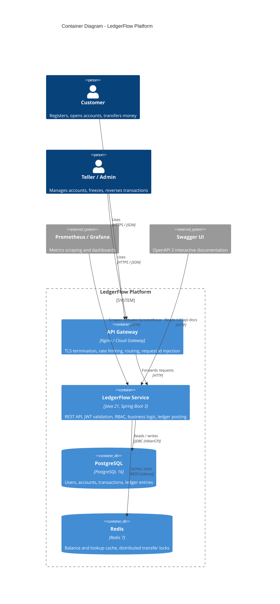
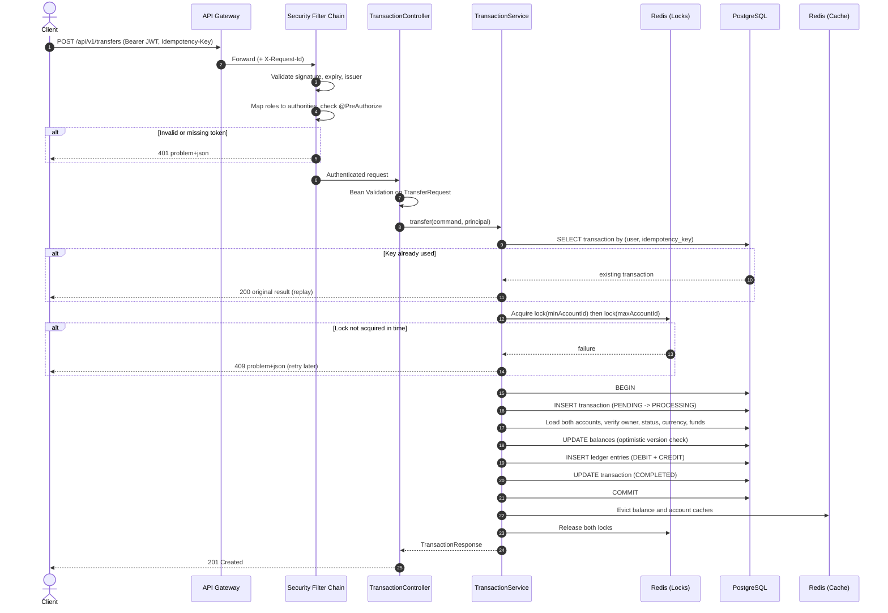
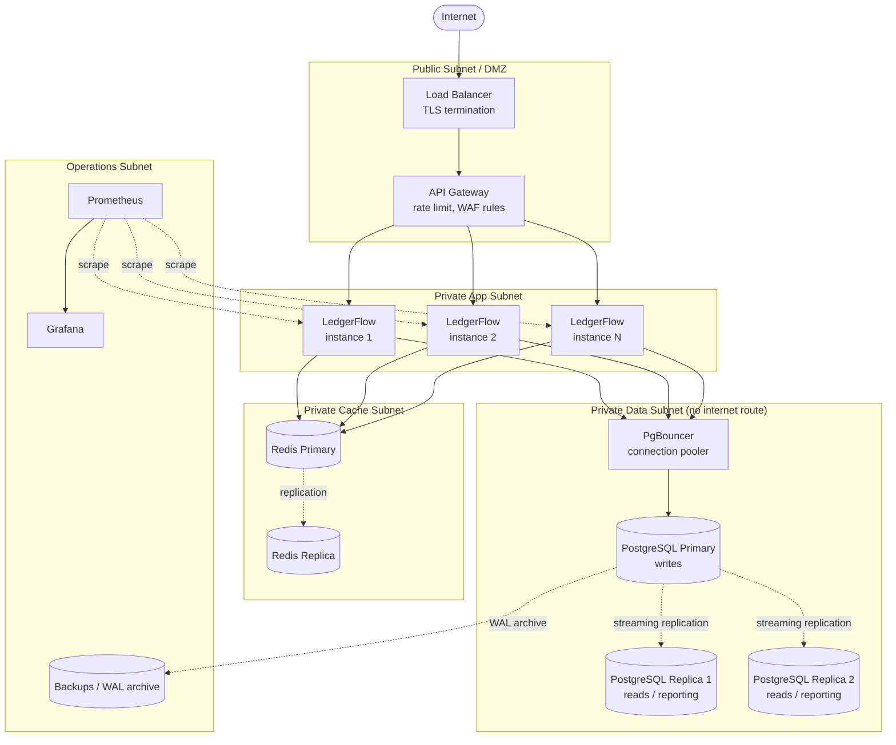
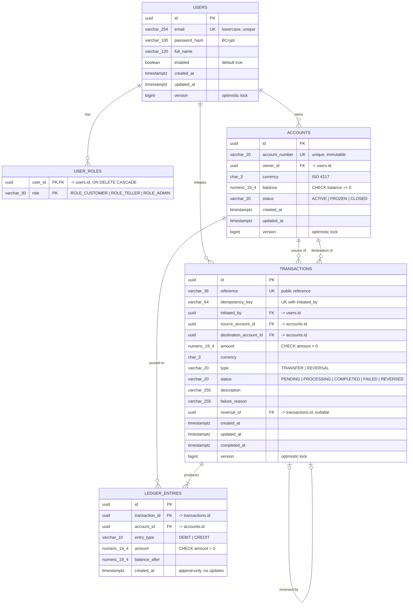
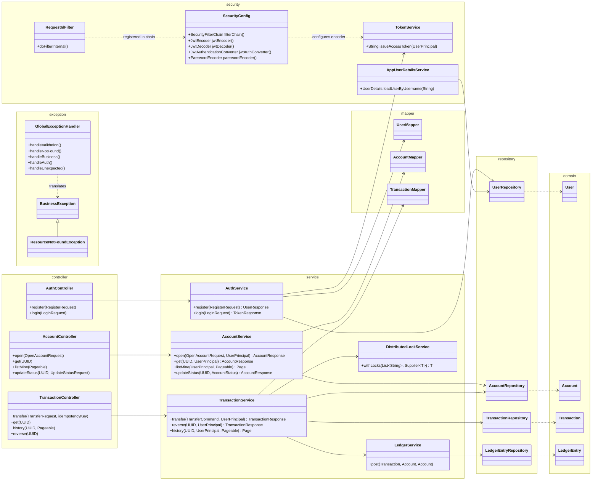
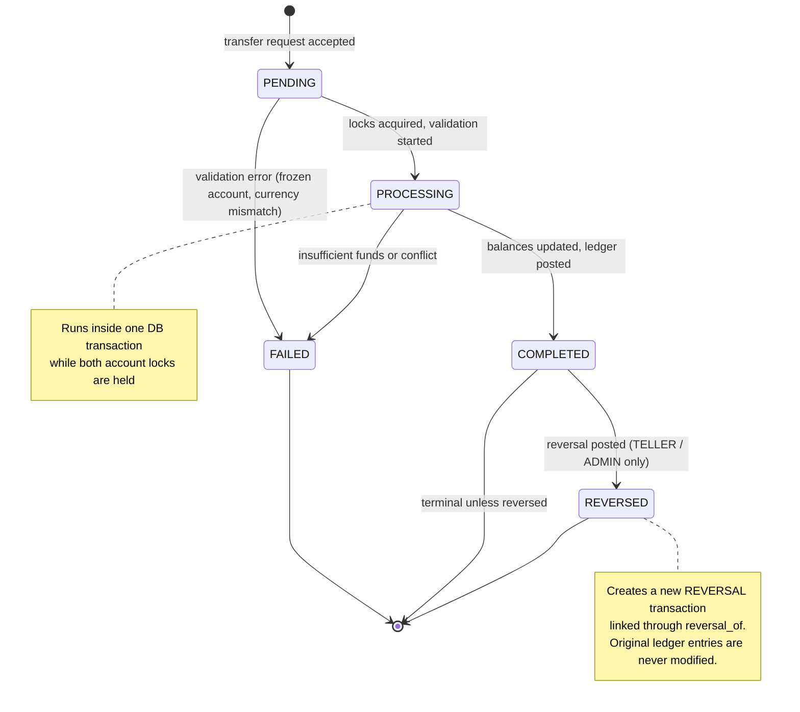

# LedgerFlow - Architecture

LedgerFlow is a stateless Spring Boot 3 / Java 21 service for customer accounts, money transfers and an immutable double-entry ledger. PostgreSQL is the system of record. Redis provides caching and distributed locking.

## Table of Contents
1. [Architectural Principles](#1-architectural-principles)
2. [High-Level Design](#2-high-level-design)
3. [Low-Level Design](#3-low-level-design)
4. [Concurrency, Idempotency & Consistency](#4-concurrency-idempotency--consistency)
5. [Caching Strategy](#5-caching-strategy)
6. [Security Model](#6-security-model)
7. [Index Rationale](#7-index-rationale)

---

## 1. Architectural Principles

| Principle | Application |
|---|---|
| Layered / Clean | `controller -> service -> repository`. Controllers only know DTOs, services own transactions and business rules, and entities never leave the service layer. |
| Stateless | No HTTP session. Identity is carried in a signed JWT, so any instance can serve any request. |
| Money correctness | `NUMERIC(19,4)` amounts, `CHECK (balance >= 0)`, optimistic `@Version`, an ordered Redis lock per transfer, and an append-only ledger. |
| Idempotent writes | A unique `(initiated_by, idempotency_key)` constraint makes retried transfers return the original result. |
| Fail loudly | A global `@RestControllerAdvice` returns RFC 7807 `application/problem+json` for every error. |
| Observable | Actuator health and metrics, Prometheus scrape endpoint, and a correlation id on every request. |

---

## 2. High-Level Design

### 2.1 System Architecture (C4 Container Diagram)

### 2.2 Data Flow & Sequence Diagram (Transfer Request)

### 2.3 Infrastructure Architecture

**Network rules**
- Only the load balancer is internet-facing. App, cache and data subnets have no public IPs.
- Security groups allow: gateway to app on 8080, app to Redis on 6379, app to PgBouncer on 5432, and Prometheus to app on the management port.
- The service itself uses a single JDBC datasource that points at the primary through the pooler. Replicas serve reporting and analytics, and failover is handled at the infrastructure layer (Patroni or a managed service).
- Redis is a cache and lock store only. Losing it degrades performance and fails transfers closed (see section 4), but it never loses money data.

---

## 3. Low-Level Design

### 3.1 Entity Relationship Diagram

**Constraints beyond the diagram**
- `accounts`: `CHECK (balance >= 0)`, `CHECK (status IN ('ACTIVE','FROZEN','CLOSED'))`, `CHECK (currency = upper(currency))`.
- `transactions`: `CHECK (amount > 0)`, `CHECK (source_account_id <> destination_account_id)`, `UNIQUE (initiated_by, idempotency_key)`, and a status `CHECK` matching the state machine.
- `ledger_entries`: a trigger rejects `UPDATE` and `DELETE`, so history cannot be rewritten even by a bug.
- Foreign keys use `ON DELETE RESTRICT`, except `user_roles`, which uses `CASCADE`.

### 3.2 Class & Layered Architecture Diagram

**Layer rules**
- Controllers never touch repositories or entities.
- Services are the only transactional boundary (`@Transactional`).
- Mappers are the only place where entities become DTOs.
- Exceptions propagate to `GlobalExceptionHandler`. Services never build HTTP responses.

### 3.3 State Machine - Transaction Lifecycle

| From | To | Trigger | Guard |
|---|---|---|---|
| PENDING | PROCESSING | Locks acquired | Both accounts exist |
| PENDING | FAILED | Validation | Account not ACTIVE, or currency mismatch |
| PROCESSING | COMPLETED | Ledger posted | Balance sufficient, versions match |
| PROCESSING | FAILED | Business or concurrency error | none |
| COMPLETED | REVERSED | Reversal request | Role TELLER/ADMIN, destination can cover the amount |

Any other transition throws `InvalidStateTransitionException` (HTTP 409).

---

## 4. Concurrency, Idempotency & Consistency

1. **Idempotency.** `Idempotency-Key` is required on `POST /transfers`. The service first looks up `(initiated_by, idempotency_key)`. On a hit it returns the stored transaction. If two identical requests race past the lookup, the unique constraint rejects the second insert, and the service catches that and returns the winner's result.
2. **Lock ordering.** For a transfer between A and B, the lock keys are sorted (`min(id)` first), so two opposite transfers (A to B and B to A) can never deadlock.
3. **Lock implementation.** `SET key token NX PX ttl` for acquire, and a Lua compare-and-delete script for release, so a slow holder can never release a lock it no longer owns.
4. **Fail closed.** If Redis is unreachable, the transfer is rejected with 503. Money movement never proceeds without the lock.
5. **Last line of defence.** Locks reduce contention but correctness does not depend on them. `@Version` on accounts and `CHECK (balance >= 0)` in the database both reject any conflicting or overdrawing write.
6. **Atomicity.** Balance updates, ledger rows and the status change commit in one database transaction. Cache eviction happens after commit.
7. **Invariant.** For every completed transaction, the sum of CREDIT entries equals the sum of DEBIT entries, and each account's `balance` equals its latest `balance_after`.

---

## 5. Caching Strategy

| Cache name | Key | TTL | Evicted when |
|---|---|---|---|
| `accounts` | account id | 5 min | Account status change, any transfer touching it |
| `account-balances` | account id | 30 s | Any transfer touching it |
| `user-accounts` | user id | 2 min | Account opened or status changed |

- Cache values are DTOs (JSON serialised), never JPA entities.
- Transfers always read balances from the database under lock. The cache serves read endpoints only.
- A cache failure falls back to the database through a custom `CacheErrorHandler`.

---

## 6. Security Model

| Endpoint group | Access |
|---|---|
| `POST /api/v1/auth/**` | Public |
| `/actuator/health/**`, `/v3/api-docs/**`, `/swagger-ui/**` | Public |
| `/actuator/**` (others) | `ROLE_ADMIN` |
| `POST /api/v1/accounts`, `GET /api/v1/accounts/mine`, `POST /api/v1/transfers` | `ROLE_CUSTOMER`, `ROLE_TELLER`, `ROLE_ADMIN` |
| `GET /api/v1/accounts/{id}`, transaction history | Owner, or `ROLE_TELLER` / `ROLE_ADMIN` |
| `PATCH /api/v1/accounts/{id}/status` | `ROLE_TELLER`, `ROLE_ADMIN` |
| `POST /api/v1/transactions/{id}/reverse` | `ROLE_TELLER`, `ROLE_ADMIN` |

- **Passwords:** BCrypt (strength 12).
- **Tokens:** HS256-signed JWT (Nimbus), 15-minute lifetime, `sub` = user id, `roles` claim, `iss` validated. The signing secret comes from the environment and is never committed.
- **Session policy:** `STATELESS`, CSRF disabled (bearer-token API), and security headers enabled.
- **Ownership checks:** performed in the service layer, in addition to role checks on the endpoint.
- **Errors:** 401 (`AuthenticationEntryPoint`) and 403 (`AccessDeniedHandler`) both return RFC 7807 bodies.

---

## 7. Index Rationale

| Index | Access pattern served |
|---|---|
| `accounts(account_number)` UNIQUE | Lookup by public account number |
| `accounts(owner_id, status)` | "My active accounts" |
| `transactions(initiated_by, idempotency_key)` UNIQUE | Idempotent replay lookup |
| `transactions(reference)` UNIQUE | Lookup by public reference |
| `transactions(source_account_id, created_at DESC)` | Outgoing history, paged |
| `transactions(destination_account_id, created_at DESC)` | Incoming history, paged |
| `transactions(status, created_at)` | Operational monitoring of stuck PENDING/PROCESSING rows |
| `ledger_entries(account_id, created_at DESC)` | Account statement |
| `ledger_entries(transaction_id)` | Ledger rows for one transaction |
| `users(email)` UNIQUE | Login lookup |
